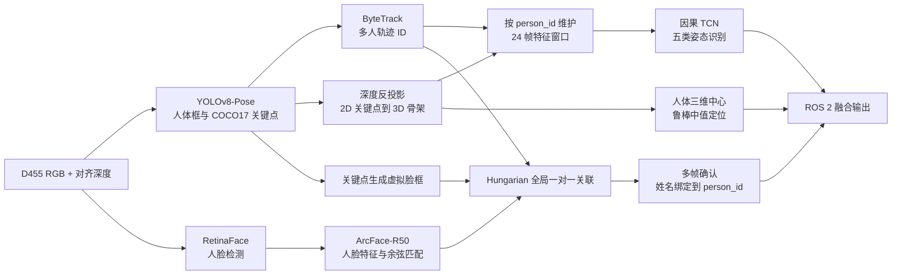

# 基于 RGB-D 视觉的多人身份、三维定位与静态姿态识别系统

## 1. 项目概述

本项目面向机器人室内人机交互场景，使用头部 Intel RealSense D455 同时获取彩色图像与对齐深度图，在 ROS 2 Humble 下完成多人的持续跟踪、身份识别、三维定位和静态姿态识别。系统最终为画面中的每个人输出统一的 `person_id`、姓名、姿态、置信度及相机坐标系三维位置。

系统当前识别五类静态姿态：**站立、坐下、蹲、躺、弯腰**。整体方案不是直接对 RGB 图像做端到端分类，而是采用“二维姿态估计 → RGB-D 三维骨架恢复 → 时序特征分类”的路线。这种设计减少了背景、衣着和光照对姿态分类的影响，同时能够复用三维骨架完成空间定位。

本项目的人体姿态部分迁移并改造自开源项目 [USTC-WrightEagle-AI/27-WrightEagle.Human-static-posture-recognition-by-pzy](https://github.com/USTC-WrightEagle-AI/27-WrightEagle.Human-static-posture-recognition-by-pzy)。在此基础上完成了 ROS 1 到 ROS 2、本机 D455 标定、多目标跟踪、多人身份绑定、异步人脸识别和运行稳定性方面的工程改造。

## 2. 系统目标与输出

系统主要解决以下问题：

1. 从 RGB 图像中检测人体并提取 COCO17 二维骨架；
2. 在多人场景下为同一人维持相对稳定的轨迹 ID；
3. 利用对齐深度图和相机内参恢复三维骨架及人体位置；
4. 利用连续 24 帧三维姿态特征识别五类静态姿态；
5. 识别人脸，并将姓名可靠地绑定到对应的人体轨迹；
6. 通过 ROS 2 发布结构化 JSON 和可视化图像。

核心输出话题如下：

| ROS 2 话题 | 内容 |
|---|---|
| `/pose_classifier_3d/results` | ID、姓名、姿态、置信度、三维坐标等完整结果 |
| `/person_identity_locations` | ID、姓名与三维位置的精简结果 |
| `/pose_classifier_3d/image` | 检测框、骨架、身份和姿态叠加图像 |

## 3. 总体技术路线

运行时的主链路为：

1. ROS 2 同步接收 `640×480@15 FPS` 的 RGB 图像、彩色相机内参和对齐到彩色坐标系的深度图；
2. YOLOv8n-Pose 在整帧中检测所有人体，输出人体框和 17 个 COCO 关键点；
3. ByteTrack 关联相邻帧检测，为每个人分配 `person_id`；
4. 根据深度值和相机内参将每个二维关键点反投影到三维空间；
5. 对每条轨迹独立维护姿态特征历史，输入因果 TCN 完成姿态分类；
6. 人脸识别在独立 Python/Conda 子进程中异步执行，避免阻塞姿态主循环；
7. 使用人体头部关键点构造虚拟脸框，通过全局匹配将真实人脸分配给人体轨迹；
8. 将身份、姿态和位置按同一个 `person_id` 融合并发布。

## 4. 关键算法

### 4.1 YOLOv8-Pose 人体检测与二维骨架提取

系统使用 Ultralytics YOLOv8n-Pose 预训练模型。单次前向推理同时得到人体边界框和 COCO17 关键点，关键点包含二维坐标与置信度。运行阈值为 `0.35`，输入尺寸为 `640`。

选择轻量级 `yolov8n-pose` 的主要原因是机器人需要在线处理视频流，模型速度和显存占用比单纯追求离线精度更重要。YOLOv8 没有正式发表的同名论文，因此本报告将其列为开源工程方法，而不虚构论文出处；其网络思想承接 YOLO 系列的单阶段检测框架。

### 4.2 ByteTrack 多目标跟踪

系统通过 Ultralytics 的 `track(..., persist=True)` 接入 ByteTrack。ByteTrack 的关键思想是除高置信度检测框外，也利用低置信度检测框参与轨迹关联，从而减少遮挡或姿态变化造成的轨迹中断。

本项目中 ByteTrack 不只是显示层的跟踪器，而是所有信息融合的主索引：

- 每个 ID 拥有独立的 TCN 时序窗口；
- 人脸姓名绑定到对应 ID；
- 姿态和三维位置与该 ID 同步输出；
- 轨迹短时丢失后保留一定寿命，减少身份和历史特征立即清空。

当前跟踪配置包括：高/低检测阈值 `0.35/0.10`、新轨迹阈值 `0.40`、轨迹缓冲 `150` 帧、匹配阈值 `0.85`。

### 4.3 RGB-D 反投影与深度鲁棒处理

对齐深度图中的像素深度记为 \(Z\)，彩色相机内参为 \(f_x,f_y,c_x,c_y\)，二维关键点为 \((u,v)\)。针孔相机反投影公式为：

\[
X=\frac{(u-c_x)Z}{f_x},\qquad
Y=\frac{(v-c_y)Z}{f_y},\qquad
Z=Z(u,v)
\]

由此将每个 COCO17 关键点变换为相机光学坐标系下的 `[X,Y,Z,valid]`。坐标约定为 `+X` 向右、`+Y` 向下、`+Z` 向前。

针对 RealSense 深度噪声，工程上加入了以下处理：

- 仅接受 `0.3～10.0 m` 的有效深度；
- 中心像素有效时，在相近深度的 `3×3` 邻域内取中值，抑制飞点且避免混入背景；
- 中心为空时，逐圈搜索半径 5 像素内的有效深度，并取最近有效环的中值；
- 肩、髋深度存在明显离群时，以躯干深度中位数修正；
- 人体位置优先取双肩和双髋有效三维点的中位数，缺失时再回退至腿部或全部有效点。

### 4.4 三维姿态特征设计

TCN 的每帧输入为 62 维特征。首先从 COCO17 中保留头部、双肩、双肘、双腕、双髋、双膝和双踝，共 13 个关节。随后以髋部中点为原点、躯干长度为尺度，构建由身体左右方向、重力向上方向和前向方向组成的局部坐标系。

62 维特征由三部分组成：

| 特征组成 | 维数 | 作用 |
|---|---:|---|
| 13 个关节的归一化局部三维坐标 | 39 | 描述身体空间构型 |
| 13 个关节的有效性掩码 | 13 | 显式表示深度或关键点缺失 |
| 几何统计量 | 10 | 补充关节角度、身体比例和数据质量 |

10 个几何量包括左右膝角、左右髋角、躯干倾角、身高/躯干比、体宽/躯干比、髋相对膝高度、有效关节比例和双踝高度差。该表示通过平移归一化、尺度归一化和重力方向对齐，降低了人物位置、距离和体型差异的影响。

### 4.5 24 帧因果 TCN 姿态分类

系统采用因果时序卷积网络（Temporal Convolutional Network, TCN）。每条 ByteTrack 轨迹维护独立的 24 帧窗口；历史不足时用最早一帧左侧填充，但至少积累 6 帧后才输出有效分类。

网络结构如下：

1. 对 62 维输入按训练集均值和标准差归一化；
2. 计算一阶帧间速度，并与位置特征拼接为 124 维；
3. 用 `1×1 Conv1d` 投影到 96 个通道；
4. 经过 4 个时序残差块，膨胀率依次为 `1、2、4、8`，卷积核大小为 3；
5. 每个残差块包含两层左侧填充的因果卷积、LayerNorm、SiLU 和 Dropout；
6. 取当前时刻特征，经两层全连接网络输出五类 logits，再用 Softmax 得到概率。

因果卷积只访问当前帧及过去帧，不使用未来帧，适合实时在线推理。当前模型约含 **240,705 个参数**，分类置信度低于 `0.4` 时输出“未知”。短时深度缺失最多沿用历史 3 次，避免单帧空洞导致结果抖动。

项目还针对现场常见的“深蹲被判为坐下或躺下”加入几何保护规则：只有当膝角、髋角、身高比、躯干倾角和有效关键点比例同时满足条件时，才将结果校正为“蹲”。该规则是部署后的工程补偿，不属于原始 TCN 论文方法。

### 4.6 RetinaFace、ArcFace 与本地人脸库

人脸模块采用 InsightFace `buffalo_l` 模型包：

- RetinaFace (`det_10g.onnx`) 负责人脸检测与定位；
- ArcFace-R50 (`w600k_r50.onnx`) 提取 L2 归一化人脸嵌入；
- 本地人脸库只保存姓名及特征向量，不保存原始照片。

录入时默认采集 20 个合格样本，将多帧嵌入求平均后再次进行 L2 归一化，得到一个人的原型向量。识别时对待测向量 \(e\) 与数据库原型 \(p_i\) 计算余弦相似度。由于二者均已归一化，可直接写为：

\[
s_i=p_i^T e,\qquad i^*=\arg\max_i s_i
\]

最高分达到阈值 `0.45` 时输出对应姓名，否则输出 `Unknown`。录入阶段还利用对齐深度选择最近人脸，并要求最近两人的深度差至少为 `0.15 m`，降低多人画面中录错对象的概率。

### 4.7 人脸与人体轨迹关联

人脸检测框和人体框来自不同模型，不能仅按检测顺序对应。本项目根据鼻、眼、耳及肩部关键点为每条人体轨迹生成“虚拟脸框”，再计算真实脸框与虚拟脸框之间的综合得分：

\[
S=0.55\,IoU+0.15\,IoM+0.20\,S_{center}+0.10\,S_{scale}
\]

其中 `IoM` 为交集面积除以两框较小面积，`S_center` 衡量中心距离一致性，`S_scale` 衡量尺度一致性。随后使用 Hungarian 算法在整帧内求解全局一对一最大权匹配，并以 `IoU ≥ 0.08`、综合分数 `S ≥ 0.25` 过滤弱匹配。

姓名不会因单帧识别立即绑定：同一轨迹需要至少连续获得 2 次一致的已知身份结果，且同一姓名不能同时绑定到另一条活跃轨迹。这样可降低多人交叉、误检和偶发人脸误认导致的串名。

### 4.8 异步推理与系统集成

姿态主程序运行在 `foundationpose` 环境，人脸模型运行在独立的 `robot-face` Python 3.10 环境。主进程每 5 帧向人脸子进程提交一次任务，使用长度前缀的二进制协议传输压缩 NumPy 数据；输入、输出队列只保留最新任务和结果。人脸处理变慢时会丢弃旧任务而不是堵塞视频主循环。

这种设计解决了 ROS 2、PyTorch、InsightFace 和 ONNX Runtime 对 Python 与依赖版本要求不同的问题，同时保证姿态检测链路的实时性。

## 5. 借鉴的方法、论文与开源项目

| 方法/资源 | 本项目中的用途 | 借鉴方式 |
|---|---|---|
| YOLOv8-Pose / Ultralytics | 人体检测、COCO17 二维关键点 | 使用预训练模型与跟踪接口；属于开源工程方案 |
| ByteTrack | 多人持续跟踪 | 使用“关联每个检测框”的跟踪思想及 Ultralytics 集成 |
| TCN | 24 帧姿态时序建模 | 使用因果卷积、膨胀卷积和残差结构；按本项目特征维度定制 |
| NTU RGB+D 120 | 姿态/动作训练数据来源之一 | 权重元数据表明训练数据由其处理得到 |
| FUKinect-Fall | 跌倒/躺姿相关训练数据来源之一 | 权重元数据表明与 NTU 数据共同形成训练数据 |
| RetinaFace | 人脸检测 | 直接使用 InsightFace 模型包中的预训练检测器 |
| ArcFace | 人脸表征 | 使用 R50 预训练模型提取判别性嵌入，并做余弦匹配 |
| Hungarian algorithm | 人脸框与人体轨迹全局分配 | 对综合关联分数矩阵求一对一最优分配 |
| RealSense RGB-D / 针孔模型 | 三维骨架与人体坐标计算 | 使用对齐深度、在线内参和标准反投影公式 |
| 上游 WrightEagle 项目 | 原始静态姿态识别工程 | 迁移模型和总体思路，并完成 ROS 2 与多人身份融合改造 |

主要参考文献如下：

1. Zhang, Y. et al. **ByteTrack: Multi-Object Tracking by Associating Every Detection Box**. ECCV, 2022. [arXiv:2110.06864](https://arxiv.org/abs/2110.06864)
2. Bai, S., Kolter, J. Z., Koltun, V. **An Empirical Evaluation of Generic Convolutional and Recurrent Networks for Sequence Modeling**. 2018. [arXiv:1803.01271](https://arxiv.org/abs/1803.01271)
3. Deng, J. et al. **RetinaFace: Single-Shot Multi-Level Face Localisation in the Wild**. CVPR, 2020. [论文页面](https://openaccess.thecvf.com/content_CVPR_2020/html/Deng_RetinaFace_Single-Shot_Multi-Level_Face_Localisation_in_the_Wild_CVPR_2020_paper.html)
4. Deng, J. et al. **ArcFace: Additive Angular Margin Loss for Deep Face Recognition**. CVPR, 2019. [论文页面](https://openaccess.thecvf.com/content_CVPR_2019/html/Deng_ArcFace_Additive_Angular_Margin_Loss_for_Deep_Face_Recognition_CVPR_2019_paper.html)
5. Liu, J. et al. **NTU RGB+D 120: A Large-Scale Benchmark for 3D Human Activity Understanding**. IEEE TPAMI, 2020. [arXiv:1905.04757](https://arxiv.org/abs/1905.04757)
6. Aslan, M. et al. **Eklem tabanlı etkili düşme tespiti（Joint-Based Efficient Fall Detection）**. Journal of the Faculty of Engineering and Architecture of Gazi University, 2017. [DOI:10.17341/gazimmfd.369347](https://doi.org/10.17341/gazimmfd.369347)（FUKinect-Fall 相关论文）
7. Kuhn, H. W. **The Hungarian Method for the Assignment Problem**. Naval Research Logistics Quarterly, 1955.
8. Ultralytics. **YOLOv8 Documentation and Repository**. [GitHub](https://github.com/ultralytics/ultralytics)
9. InsightFace. **2D and 3D Face Analysis Project**. [GitHub](https://github.com/deepinsight/insightface)

需要说明的是：使用某个预训练模型不等于重新实现了其论文全部训练过程。本项目对 RetinaFace、ArcFace 和 YOLOv8-Pose 主要采用官方/社区预训练权重；对 ByteTrack 使用框架集成实现；对 TCN 则使用上游权重并在当前工程中实现了相匹配的推理网络。

## 6. 本项目的主要工程改进

相对于上游静态姿态识别工程，本项目的主要工作包括：

1. **平台迁移**：从 ROS 1 Noetic 和原设备迁移至 ROS 2 Humble 与本机头部 D455；
2. **严格相机校验**：启动时核对设备序列号、流配置和实时 CameraInfo，避免错误设备或错误内参造成坐标偏差；
3. **多人处理**：由单目标/最近人员扩展为全画面多人检测，并用 ByteTrack 统一管理时序状态；
4. **三维特征增强**：使用局部身体坐标、尺度归一化、有效性掩码和 10 项几何特征；
5. **深度抗噪**：加入邻域中值、空洞环形搜索、躯干离群修正和鲁棒人体中心估计；
6. **身份融合**：新增 RetinaFace + ArcFace 人脸分支以及人脸—人体全局一对一关联；
7. **时序稳定性**：姓名多帧确认、短时深度缺失容忍、轨迹过期回收；
8. **异步架构**：跨 Conda 环境运行人脸推理，使用最新帧队列避免阻塞；
9. **部署输出**：统一发布姿态、身份和空间位置 JSON，并提供中文可视化。

## 7. 模型与参数概览

| 模块 | 当前配置 |
|---|---|
| 相机 | Intel RealSense D455，`640×480@15 FPS` |
| 人体姿态模型 | `yolov8n-pose.pt`，输入 640，置信度阈值 0.35 |
| 跟踪器 | ByteTrack |
| 三维关键点 | COCO17 + 对齐深度反投影 |
| TCN 输入 | 24 帧，每帧 62 维；位置与一阶速度共同建模 |
| TCN 结构 | 96 通道，4 个残差块，膨胀率 1/2/4/8 |
| 姿态类别 | 站立、坐下、蹲、躺、弯腰 |
| 姿态输出阈值 | 0.4；至少 6 帧历史 |
| 人脸模型 | InsightFace `buffalo_l`：RetinaFace + ArcFace-R50 |
| 人脸相似度阈值 | 0.45 |
| 人脸执行频率 | 每 5 个处理帧一次 |
| 姓名确认 | 5 次历史中至少 2 次一致识别 |

权重文件 `pose_tcn_ntu_fukinect.pth` 的元数据显示：最佳训练轮次为 22，验证集准确率为 **96.22%**，宏平均 F1 为 **95.51%**；静态窗口验证准确率为 **93.63%**，宏平均 F1 为 **92.13%**。这些数值属于权重保存时记录的离线验证结果，不能直接等同于当前机器人现场精度。

## 8. 测试与验证

仓库测试覆盖了以下关键行为：

- TCN 因果性：改变未来帧不会影响过去时刻输出；
- 模型权重结构、类别顺序和配置路径一致性；
- ByteTrack ID 独立维护各自 TCN 历史；
- 深度反投影、空洞填补、人体距离和三维中心计算；
- 人脸数据库的录入、覆盖、删除和相似度匹配；
- 虚拟脸框构造及 Hungarian 一对一关联；
- 姓名必须经过多帧确认后才绑定；
- D455 序列号、分辨率、帧率和标定文件一致性。

## 9. 局限性与后续工作

1. **训练复现资料不完整**：仓库包含 TCN 推理结构和权重，但不包含生成 `ntu_fukinect_pose_tcn_24f.npz` 的完整数据处理及训练脚本。因此当前可以复现部署推理，不能仅凭本仓库完整复现训练过程。
2. **现场指标仍需实测**：权重中的验证指标来自训练阶段数据划分，应另外采集头部 D455 的多人、遮挡、远距离和不同俯仰角数据，报告现场混淆矩阵、端到端延迟和 FPS。
3. **重力方向近似**：当前以 RealSense 光学坐标系图像向下方向作为 `down_axis`。若头部相机存在明显俯仰或滚转，应使用 IMU 或地面平面估计真实重力方向。
4. **机械臂坐标不可用于控制**：候选手眼外参平均残差约为 `3.96 mm / 0.544°`，旋转误差未通过 `0.3°` 验收阈值。当前可信主输出是相机坐标；左臂基座坐标明确标记为未验证，不能用于抓取或安全动作。
5. **身份识别受成像质量影响**：远距离、小脸、侧脸、遮挡和逆光会降低 ArcFace 匹配可靠性，需要基于实际人员数据校准阈值。
6. **规则校正需系统验证**：深蹲几何保护阈值来自现场经验，应通过独立测试集验证其收益并监控对坐下、弯腰类别的副作用。

建议后续按“采集本机数据 → 标注五类姿态与身份 → 按人员划分训练/验证/测试集 → 重新训练或微调 → 现场压力测试”的路线完善闭环，并增加端到端身份保持率、姿态宏平均 F1、三维定位误差和实时帧率四类核心指标。

## 10. 汇报总结

本项目以三维人体骨架为核心表示，将 YOLOv8-Pose、ByteTrack、RGB-D 反投影、因果 TCN、RetinaFace、ArcFace 和 Hungarian 匹配组合成一个面向机器人的在线多人感知系统。技术上的关键不是单个模型堆叠，而是以 ByteTrack ID 为统一主键，使“这个人是谁、处于什么姿态、位于哪里”在时间和空间上保持一致。

当前系统已经形成从传感器输入、模型推理、跨模型关联到 ROS 2 输出的完整运行链路。下一阶段工作的重点应从功能打通转向数据闭环和量化评测，以本机 D455 的真实场景数据验证泛化能力、实时性和长期身份稳定性。
